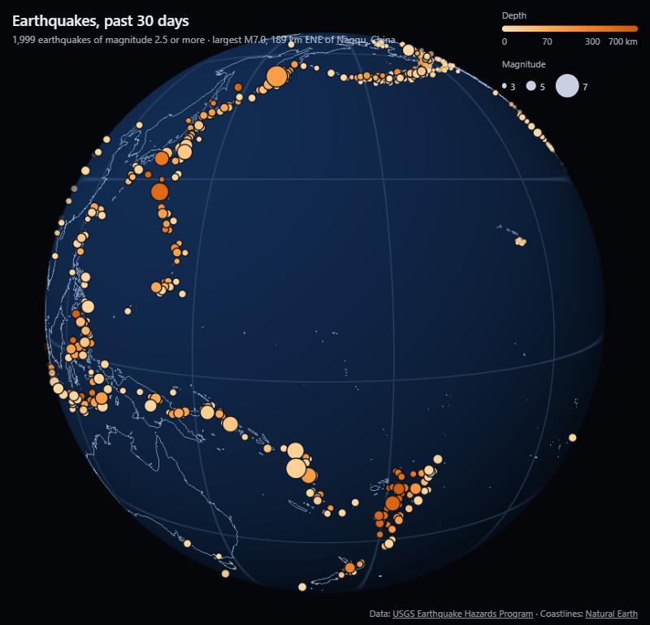

# Quake Globe

Every earthquake of magnitude 2.5 or more in the past 30 days, live from the
USGS feed, on a globe drawn with raw WebGPU and WGSL. No engine and no map
library: Vite, plain TypeScript and wgpu-matrix.

Drag to turn the globe; scroll or pinch to zoom. Hover over an earthquake for
its place, magnitude, depth and time, and click it for its USGS event page
(on a touch screen, tap once for the details and again for the page).

## How it is drawn

- **The globe is ray-cast, not tessellated.** One triangle covers the screen,
  and each pixel's fragment shader intersects its own ray with the unit sphere,
  the same quadratic as a CPU ray tracer. The silhouette is exact at any zoom.
  The graticule and lighting come from the hit point, and the edge is
  antialiased from the ray's closest approach to the centre.
- **No depth buffer.** The globe is one convex surface, so the far side of
  every line and dot is hidden by a horizon test instead: a point `p` on the
  unit sphere faces the camera exactly when `dot(p, eye − p) > 0`.
- **Earthquakes are instanced billboards.** 2,000 instances of one quad,
  sized in screen pixels by magnitude, cut to antialiased discs in the
  fragment shader, largest drawn last.
- **Depth is one hue, light to dark.** Shallow (0–70 km), intermediate
  (70–300 km) and deep (300–700 km) each get a third of an orange ramp. The
  ramp was checked for monotone lightness and single hue, and its darkest step
  clears 3.3:1 against the ocean. The deep dots trace the slabs subducting
  under Tonga, the Izu–Bonin arc and Japan.
- **Picking matches what is drawn.** On every pointer move the CPU projects
  each dot on the near side to the screen and takes the dot drawn on top
  under the pointer, or failing that the nearest within a few pixels. With
  2,000 dots this costs a fraction of a millisecond. The dot's radius is
  computed once on the CPU and sent to the GPU, so the drawing and the hit
  test cannot disagree. The hovered dot is drawn a second time, alone and
  last (`draw(6, 1, 0, index)`), with a white ring.
- **Geographic camera.** The camera hovers over a latitude and longitude at
  some altitude, and dragging moves it by the ground distance one pixel covers,
  so the ground under the pointer follows the pointer at any zoom.

## Run it

Needs a browser with WebGPU (recent Chrome, Edge or Safari).

    npm install
    npm run dev      # http://localhost:5173
    npm run build    # type-checks, then writes dist/

## Data

- Earthquakes: [USGS Earthquake Hazards Program](https://earthquake.usgs.gov/earthquakes/feed/),
  the `2.5_month` GeoJSON summary feed, fetched live on every visit.
- Coastlines: [Natural Earth](https://www.naturalearthdata.com/) 1:50m
  coastline, public domain, in `public/data/coastlines.geojson`.

What comes next is in [docs/PLAN.md](docs/PLAN.md).
